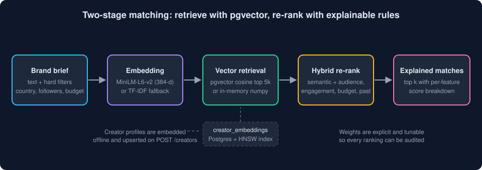
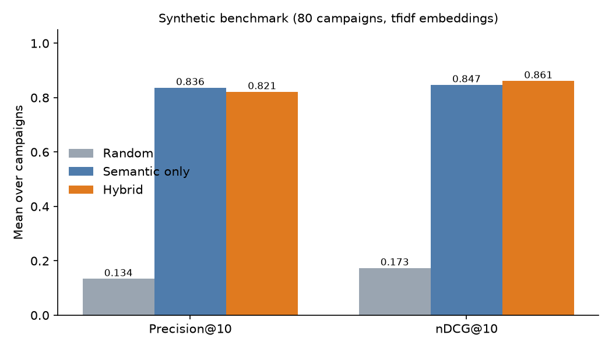

# Matchfluence Matching Engine

**Explainable brand ↔ creator matching for an influencer-marketing marketplace: embedding retrieval with pgvector, then a hybrid re-rank that says *why* each creator was picked.**


> Matchfluence is a B2B SaaS marketplace I built the backend for (Supabase). The production code is private. This repo rebuilds the **matching approach** from scratch as a standalone demo on **synthetic data**. Every brand, creator and campaign here is generated.

<p align="center"></p>

## How it works

1. **Embed:** creator profiles (niche, bio, content topics) and campaign briefs become vectors. The default is `all-MiniLM-L6-v2` via sentence-transformers. A deterministic TF-IDF embedder kicks in when that isn't installed, so everything runs offline.
2. **Retrieve (stage 1, in Postgres):** [`match_creators()`](supabase/migrations/20260101000100_match_function.sql) applies hard filters (audience country share, follower range, budget), then orders by pgvector cosine distance. It runs as `security invoker`, so [RLS](supabase/migrations/20260101000200_rls.sql) applies to the calling brand.
3. **Re-rank (stage 2, in the app):** [`scoring.py`](src/matching/scoring.py) adds the rule features to the semantic score:

   | Feature | Weight | Meaning |
   |---|---|---|
   | semantic | 0.50 | brief ↔ profile similarity, scaled to [0, 1] |
   | audience_overlap | 0.20 | share of the creator's audience in the target countries |
   | engagement | 0.10 | engagement rate vs an 8 % benchmark |
   | budget_fit | 0.10 | rate within budget, preferring creators that use it well |
   | past_performance | 0.10 | historical campaign outcome score |

4. **Explain:** every match returns its score breakdown plus a one-line reason.

```text
#1 @demo_creator_0700  score=0.788  semantic=0.49  audience_overlap=0.07  engagement=0.10 ...
    Strongest signals: brief/profile similarity (0.99), engagement (1.00). Weakest: audience overlap (0.35).
```

The same `VectorIndex` interface has an in-memory NumPy implementation (used by the demo and tests) and a pgvector implementation (`PgVectorIndex`).

## API

```bash
uvicorn matching.api:create_app --factory --app-dir src
```

| Method | Path | Purpose |
|---|---|---|
| GET | `/health` | status, number of creators, active embedder |
| GET | `/campaigns` | list campaigns |
| POST | `/campaigns/{id}/matches` | top-k explained matches (optional `k`, filters) |
| POST | `/creators` | add a creator; embedded and indexed on insert |

Interactive docs are at `/docs`.

## Results

Offline evaluation on 80 synthetic campaigns. Ground-truth relevance is graded 0–3 by the generator; "relevant" means grade ≥ 2. TF-IDF embedder, k = 10, from [`reports/results.json`](reports/results.json):

| Method | Precision@10 | nDCG@10 | Audience overlap@10 | Engagement@10 |
|---|---|---|---|---|
| Random (filtered pool) | 0.134 | 0.173 | 0.462 | 0.055 |
| Semantic only | **0.836** | 0.847 | 0.446 | 0.057 |
| Hybrid | 0.821 | **0.861** | **0.496** | **0.060** |

Hybrid vs semantic-only, with 95 % bootstrap CIs:
- nDCG@10 is **+0.015 [+0.005, +0.024]**.
- Precision@10 is **−0.015 [−0.026, −0.003]**.

Hybrid ranks the best creators higher and brings in audiences that better match the target countries. It trades a little raw precision for that.

The synthetic labels weight topical fit heavily, which favours a pure text model by construction. Treat these numbers as a sanity check of the pipeline, not as a production benchmark.

<p align="center"></p>

## Quickstart

```bash
uv venv --python 3.12 .venv && uv pip install -p .venv -r requirements.txt
# optional: real sentence embeddings
uv pip install -p .venv -r requirements-optional.txt

.venv/bin/python data/generate.py             # synthetic brands / creators / campaigns
.venv/bin/python scripts/demo.py cp_000 3     # explained top-3 for one campaign
.venv/bin/python eval/evaluate.py             # metrics + figure
.venv/bin/python -m pytest -q                 # 21 tests
```

## Project structure

```
supabase/migrations/   schema (pgvector), match_creators() SQL function, RLS policies
src/matching/          embedding.py, index.py, scoring.py, matcher.py, api.py, models.py
data/                  seeded synthetic data generator + generated JSON
eval/evaluate.py       random vs semantic vs hybrid, bootstrap CIs
scripts/demo.py        CLI demo
tests/                 scoring, filters, matcher, API
```

## Status and limits

- The SQL migrations parse cleanly but were not executed against a live Postgres in this repo. `PgVectorIndex` is not covered by the test suite.
- Weights are hand-set. Learning them from campaign outcomes (learning-to-rank) is the obvious next step.

## What I'd do next

- Learn the re-rank weights from accepted/declined offers (LambdaMART or a small pairwise model).
- Add an LLM pass that rewrites the explanation for the brand and flags brand-safety risks.
- Add integration tests against a Supabase local stack in CI.
